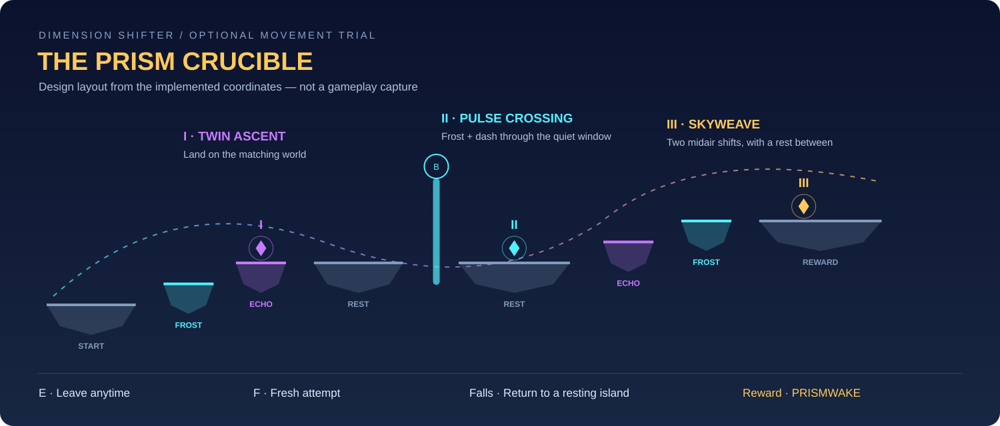

# آزمون منشور — اتاق چالش اختیاری

تاریخ: ۱۸ اکتبر ۲۰۲۶

این قابلیت با فایل‌های مستقل اضافه شده است تا ادغام آن با کار هم‌زمان نفر دوم آسان باشد. هیچ صحنه، prefab، اسکریپت قبلی، تنظیم پروژه، پکیج یا فایل README موجود برای ساخت این قابلیت ویرایش نشده است.

## چطور پیدایش کنیم؟

۱. یکی از صحنه‌های فعلی `PaintedDimension` یا `SampleScene` را اجرا کنید و سفر را شروع کنید.
۲. طبق مسیر معمول، Spirit Bolt را از اتاق مخفی بگیرید و از پورتال به مسیر اصلی برگردید.
۳. نزدیک محل بازگشت، یک پورتال نورانی با عنوان **PRISM CRUCIBLE** ظاهر می‌شود. نزدیکش بروید و **E** بزنید.

ورودی فقط پس از گرفتن Spirit Bolt ظاهر می‌شود. ورود اختیاری است؛ مسیر داستان و پایان بازی به انجام چالش وابسته نیستند. نصب خودکار در زمان اجرا انجام می‌شود و نیازی به بازسازی مرحله یا اجرای builderهای قدیمی نیست.

## تجربهٔ اتاق

- **Twin Ascent:** از سکوی Frost به سکوی Echo بروید و منشور بنفش را بگیرید. سکوهای جهان دیگر شبح‌مانند دیده می‌شوند و زیر پا قرار نمی‌گیرند.
- **Pulse Crossing:** روی جزیرهٔ پهن استراحت کنید، به Frost بروید، کنار لبه بپرید و با **B** از دروازهٔ منشوری عبور کنید. رنگ آبی یعنی فرصت عبور؛ طلایی هشدار شارژ؛ قرمز یعنی صبر کنید. فقط عبور با دش، در Frost و در پنجرهٔ آرام معتبر است.
- **Skyweave:** در هوا به Echo تغییر بُعد بدهید و روی سکوی بنفش فرود بیایید. برای آماده‌شدن Q مکث کنید، سپس دوباره در هوا به Frost بروید. دو تغییر بُعد در هوا در این بخش، منشور پایانی را فعال می‌کنند.

هشت جزیره، چهار سکوی وابسته به بُعد، دو محل استراحت میانی، سه منشور مرتب و یک سکوی جایزه وجود دارد. شکل و رنگ محیط، طاق‌های شکسته، ذرات معلق، ساعت دروازه و انفجار منشورها همگی در همین قابلیت ساخته می‌شوند. برای تشخیص وضعیت دروازه علاوه بر رنگ، نوشتهٔ `QUIET / CHARGING / WAIT` نمایش داده می‌شود.



## کنترل و جایزه

| کلید | کاربرد |
| --- | --- |
| A / D و Space | حرکت، پرش و پرش دوم فعلی |
| Q | تغییر بُعد با همان زمان بازیابی فعلی |
| B | دش فعلی |
| E | ورود از پورتال؛ داخل اتاق، خروج از هرجا |
| F | شروع یک تلاش تازه از ابتدای اتاق |
| T | فعال یا پنهان‌کردن جایزه پس از آزادشدن |
| Esc | منوی توقف فعلی |

جایزه **Prismwake** است: یک ردّ نور آبی–بنفش–طلایی و منشور کوچک همراه شخصیت. این جایزه تزئینی است؛ آسیب، سرعت، پرش، سلامت و ظاهر اصلی شخصیت را تغییر نمی‌دهد. پس از بازگشت و مرگ/بازگشت به چک‌پوینت در همین سفر باقی می‌ماند. با شروع سفر تازه یا بارگذاری مجدد صحنه پاک می‌شود؛ ذخیره روی دیسک اضافه نشده است.

زمان، تعداد بازگشت‌ها، پیشرفت منشورها و بهترین زمان همان سفر در رابط مستقل نمایش داده می‌شوند. زمان هنگام توقف و بعد از موفقیت جلو نمی‌رود. محدودیت زمانی برای اتمام وجود ندارد. مدال طلا: حداکثر ۵۵ ثانیه بدون سقوط؛ نقره: حداکثر ۹۰ ثانیه با حداکثر دو سقوط؛ سایر اتمام‌ها برنز می‌گیرند. این آستانه‌ها فعلاً پارامترهای اولیهٔ طراحی هستند و هنوز با بازیکن واقعی تنظیم نشده‌اند.

## رفتار بازگشت و حفاظت از مسیر اصلی

- سقوط یا برخورد نامعتبر با دروازه، بدون آسیب و بدون احیای سلامت، بازیکن را به آخرین جزیرهٔ امن داخلی برمی‌گرداند.
- منشورهای گرفته‌شده در بازگشت داخلی حفظ می‌شوند؛ شمارش تغییر بُعدِ بخش پایانی دوباره از صفر شروع می‌شود.
- اگر بدون دو تغییر بُعد هوایی به منشور پایانی برسید، راهنما نمایش داده می‌شود و فقط همان بخش پایانی از جزیرهٔ امن تکرار می‌شود؛ لازم نیست برای تلاش دوباره مسیر را برگردید.
- هیچ فراخوانی به `RunProgress.SetCheckpoint`، سیستم کوئست، امتیاز یا تغییر آمار مبارزه اضافه نشده است.
- خروج عادی، موقعیت و بُعد ثبت‌شدهٔ هنگام ورود و حدود قبلی دوربین را بازمی‌گرداند.
- اگر سیستم دیگری بازیکن را بیرون اتاق منتقل کند، موقعیت تازه‌اش حفظ می‌شود و اتاق فقط کنترل دوربین را پس می‌دهد.
- مرگ از یک منبع خارجی، خروج ایمن را انجام می‌دهد و بازیکن را زنده نمی‌کند؛ منوی مرگ و شروع مجدد فعلی همچنان مسئول ادامه هستند.
- پس از موفقیت، سقوط به سکوی جایزه برمی‌گرداند. خروج با E همچنان همیشه ممکن است.
- تغییر بُعد از API فعلی `DimensionController.SetDimension` استفاده می‌کند؛ بنابراین همان رفتار فعلیِ تغییر حضور دشمنان و پاک‌کردن پرتابه‌های دشمن اجرا می‌شود.
- زمان کل سفر اصلی طبق رفتار فعلی بازی، زمان حضور در چالش را نیز حساب می‌کند؛ تایمر مستقل اتاق علاوه بر آن نمایش داده می‌شود.

## فایل‌های جدید و مسئولیت آن‌ها

تمام محتوای واردشونده به بازی در پوشهٔ مستقل `Assets/PrismChallenge/` است:

| فایل | مسئولیت |
| --- | --- |
| `Runtime/PrismChallengeBootstrap.cs` | نصب یک‌باره پس از بارگذاری صحنهٔ دارای DemoSession و LevelGenerator با مسیر طراحی‌شده |
| `Runtime/PrismChallengeRoom.cs` | یافتن ورودی، ورود/خروج، پیشرفت، بازگشت محلی و بازگرداندن دوربین |
| `Runtime/PrismChallengeRules.cs` | قوانین منشورها، دروازه، زمان، سقوط و مدال؛ مستقل از Unity |
| `Runtime/PrismChallengeVisuals.cs` | ساخت هندسه، سکوها، نورها، متن‌ها و ذرات با تعداد محدود |
| `Runtime/PrismChallengeHUD.cs` | رابط مستقل اتاق و دعوت ورود؛ بدون ویرایش HUD فعلی |
| `Runtime/PrismwakeReward.cs` | ردّ نور و نشان تزئینی مستقل از renderer اصلی شخصیت |
| `Resources/PrismChallenge/PrismSprites.mat` | همان شیدر استاندارد URP دوبعدی موجود در پروژه، با متریال جدا |
| `Resources/PrismChallenge/PrismUnlit.shader` و `.mat` | شیدر/متریال اختصاصی حلقه‌ها و ردّ نور، با مرجع قابل‌بسته‌بندی در build |

همهٔ فایل‌ها و پوشه‌های Unity دارای `.meta` مستقل و GUID ثابت هستند. بافت‌های کوچک در زمان اجرا ساخته و هنگام تخریب قابلیت آزاد می‌شوند؛ فایل تصویری یا صوتی خارجی جدید و وابستگی پکیجی جدیدی اضافه نشده است. صداها از `GameAudio` موجود استفاده می‌کنند. افکت‌ها از تصادفی‌ساز عمومی Unity استفاده نمی‌کنند تا ترتیب تصادفی محتوای بازی را تغییر ندهند.

فایل‌های کمکی بیرون از محتوای runtime:

- `Tools/Validation/validate_prism_challenge.py`: کنترل آفلاین ساختار، منابع، GUIDها، تقریب مسیر پرش و بررسی اختیاری نحو C#.
- `Tools/Validation/Editor/PrismChallengeChecks.cs`: آزمون‌های آمادهٔ اجرا در Unity، مطابق الگوی فعلی تست‌های پروژه.
- همین فایل و `Docs/PrismChallengeLayout.svg`: توضیحات ادغام و نقشهٔ واقعی مختصات طراحی؛ نقشه، اسکرین‌شات بازی نیست.

## نکات ادغام برای هم‌تیمی

برای انتقال قابلیت، پوشهٔ `Assets/PrismChallenge` و فایل `Assets/PrismChallenge.meta` را **همراه تمام فایل‌های .meta** منتقل کنید. پوشهٔ Docs و دو فایل validation را هم برای مستندات و بررسی نگه دارید. نیازی به جایگزین‌کردن فایل‌های شخص دیگر نیست. برای حذف قابلیت، فقط پوشهٔ اختصاصی و meta کنار آن کافی است؛ فایل‌های قبلی به آن ارجاع سریال‌شده ندارند.

ورودی با نام چانک یا مختصات ثابت پیدا نمی‌شود: اسکریپت، یک `QuestInteractable` از نوع `ReturnPortal` را پیدا می‌کند و نزدیک `destination` آن روی زمین ورودی می‌گذارد. اگر اتاق مخفی جابه‌جا شود ولی معنای همین پورتال و destination حفظ شود، ورودی نیز محل جدید را دنبال می‌کند. اگر پورتال حذف یا نوع آن عوض شود، ورودی نمایش داده نمی‌شود؛ برای اتصال جدید، فقط `FindEntrance` در فایل اختصاصی اتاق را تغییر دهید.

پیش‌نیازهای باقی‌مانده از پروژهٔ فعلی: زمین روی لایهٔ ۸، دو بُعد با شمارهٔ ۰ و ۱، API فعلی حرکت/دش/سلامت/دوربین، دوربین اصلی با `CameraFollow` و اجرای تک‌صحنه‌ای معمول بازی. هندسه بر اساس سرعت ۴، پرش ۱۶، یک پرش هوایی و دش فعلی چیده شده است. اگر هم‌تیمی این اعداد یا لایه‌ها را عوض کرد، مسیر جدید باید دوباره بررسی شود. زمان بازیابی مهارت‌ها توسط اتاق دست‌کاری نمی‌شود.

اتاق بالاتر از سقف colliderهای فعلی ساخته می‌شود و حدود دوربین تنها در طول حضور داخل آن موقتاً تغییر می‌کنند. صحنه یا prefab ذخیره‌شده در دیسک تغییر نمی‌کند. پورتال روی مسیر اختیاری پس از sanctuary قرار دارد؛ چانک‌های مسیر اصلی و ترتیب تولید آن‌ها ویرایش نشده‌اند.

## بررسی انجام‌شده و محدودیت‌ها

در محیط فعلی Unity Editor نصب‌شده پیدا نشد. بنابراین **کامپایل Unity، اجرای فیزیک داخل موتور، بررسی بصری داخل بازی و ساخت خروجی انجام نشده‌اند**. هیچ ادعای عبور تست‌های Play Mode یا آماده‌بودن build نهایی وجود ندارد.

۷۱ بررسی آفلاین پاس شدند: نحو شش اسکریپت runtime و آزمون Unity، metadata و یکتایی GUIDها، اتصال متریال/شیدر، مسیرهای تقریبی پرش و دش در هر دو صحنه با شتاب روشن و خاموش، و چند قرارداد حفاظت از وضعیت بازی. تقریب مسیر، برخورد واقعی capsule، ایمنی تغییر بُعد و حس کنترل را جایگزین نمی‌کند.

اجرای بررسی آفلاین از ریشهٔ پروژه:

```sh
python3 Tools/Validation/validate_prism_challenge.py
```

بررسی نحو اختیاری از `tree-sitter` و `tree-sitter-c-sharp` استفاده می‌کند. هنگام توسعه این ابزارها فقط در پوشهٔ موقت سیستم نصب شدند؛ به پکیج‌ها یا وابستگی‌های پروژه اضافه نشده‌اند. بدون آن‌ها بخش نحو با SKIP گزارش می‌شود و سایر بررسی‌ها همچنان اجرا می‌شوند.

برای بررسی داخل موتور، **از یک کپی جدا از پروژه استفاده کنید**؛ این دستور صحنهٔ کپی را باز و ادیتور را پس از ثبت نتیجه می‌بندد. طبق روش فایل‌های validation موجود، فایل `PrismChallengeChecks.cs` را در `Assets/Editor` همان کپی قرار دهید، سپس اجرا کنید:

```sh
"/path/to/Unity" -batchmode -projectPath "/path/to/isolated-copy" \
  -executeMethod PrismChallengeChecks.Run -logFile "/tmp/prism-challenge-unity.log"
```

خروجی آزمون در `prism-challenge-results.txt` همان کپی نوشته می‌شود. این مجموعه شامل قوانین پیشرفت، نصب خودکار، حفظ سلامت/چک‌پوینت، پرش با controller و collider واقعی با دو حالت شتاب، عبور دش، سقوط، بازگشت دوربین و جایزه است. این آزمون هنوز در این محیط اجرا نشده است.

پیش از ادغام نهایی یا تحویل: یک دور ورود و خروج در هر دو صحنه، سقوط در هر سه بخش، Q کنار لبه‌ها، دروازه در هر سه وضعیت، توقف و ادامه، F پس از شکست/موفقیت، T، مرگ پس از خروج، شروع سفر تازه و یک build مستقل را در Unity بررسی کنید. آستانهٔ مدال‌ها و خوانایی متن‌ها نیز با تجربهٔ واقعی تنظیم شوند.
